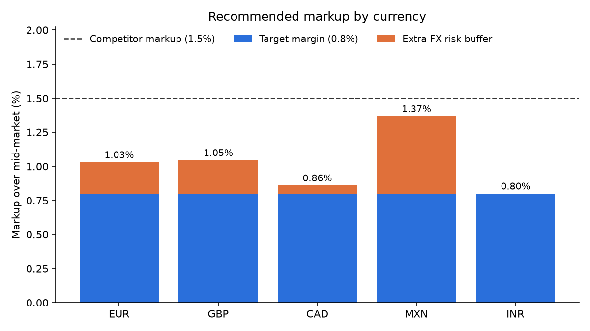
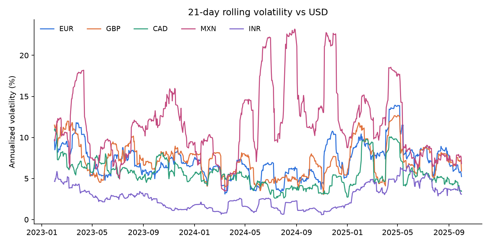

# FX Pricing Margin Analysis

> **Finding:** markups based on volatility (0.80% for INR to 1.37% for MXN) beat a flat 1.5% bank markup by $1.33–$7.00 per $1,000 and still earn a ≥0.8% margin. Tested out of sample on 2025, they held for CAD, MXN and INR but lost money twice as often for EUR and GBP as the dollar fell.

How much should a money-transfer provider mark up the mid-market rate on a USD → foreign currency transfer, given that the exchange rate can move against it before it covers the trade?

This project uses 2023–2025 daily ECB reference rates for **EUR, GBP, CAD, MXN and INR**. For each currency it estimates the smallest markup that:

1. earns at least a **0.8% target margin**, and
2. turns a transfer into a loss on **no more than 5% of days**, after a 2-business-day move in the exchange rate.

It then backtests that markup on every day in the sample and compares it with a **1.5% bank-style markup**.

## Results (2023-01-02 to 2025-10-01, 704 trading days)

| Currency | Annualized vol | Recommended markup | Customer saving per $1,000 vs 1.5% | Backtest mean margin | Days with a loss |
|---|---|---|---|---|---|
| EUR | 7.4% | 1.03% | $4.69 | 1.00% | 5.0% |
| GBP | 7.6% | 1.05% | $4.54 | 1.01% | 5.0% |
| CAD | 5.9% | 0.86% | $6.40 | 0.87% | 5.0% |
| MXN | 12.3% | 1.37% | $1.33 | 1.34% | 5.0% |
| INR | 3.1% | 0.80% | $7.00 | 0.82% | 0.9% |




**Takeaways**
- The markup a currency needs tracks its volatility. MXN is about 4× as volatile as INR, so it needs about 0.57 points more markup than the 0.8% target. INR needs no extra markup beyond the target.
- In every currency, a volatility-based markup still undercuts a flat 1.5% bank markup, saving customers about $1.33–$7.00 per $1,000. The provider still averages a margin at or above 0.8%.
- A flat markup ignores risk. At 1.5%, the provider gives up price competitiveness in low-volatility currencies like INR and CAD, but has the least margin of safety in MXN.

## Out-of-sample test (fit 2023–2024, test 2025)

The results above are fitted and backtested on the same data. To check that the markups hold up on data the model hasn't seen, I fitted them on 2023-01-02 to 2024-12-27 only, then applied them unchanged to 2025-01-02 to 2025-09-29 (190 quotes).

| Currency | Markup fitted on 2023–24 | Days with a loss, 2023–24 | Days with a loss, 2025 | Mean margin, 2025 |
|---|---|---|---|---|
| EUR | 0.91% | 5.1% | 11.6% | 0.77% |
| GBP | 0.96% | 5.1% | 10.5% | 0.87% |
| CAD | 0.85% | 5.1% | 5.3% | 0.82% |
| MXN | 1.34% | 5.1% | 6.3% | 1.21% |
| INR | 0.80% | 0.4% | 2.1% | 0.84% |

**What it shows**
- CAD, MXN and INR held up: their loss rates stayed close to the 5% limit, and their average margins stayed above 0.8%.
- EUR and GBP did not. Their loss rates roughly doubled, and EUR's average margin slipped just below target. In 2025 the dollar fell steadily: −11.4% against EUR and −7.0% against GBP from 2024-12-31 to 2025-10-01. Most 2-day moves went against a provider selling those currencies.
- The lesson: a markup taken from a historical percentile assumes moves are random around zero. It needs re-fitting on a rolling window, or a hedge, when the currency is trending. A natural next step is to re-fit monthly on the trailing 12 months.

## Method

- **Rates:** USD → X mid-market rates from the Frankfurter API, which serves ECB reference rates.
- **Quote:** the customer receives `mid_t × (1 − markup)` units per USD.
- **Cost:** the provider buys those units `h` business days later at `mid_{t+h}`. The realized margin is `1 − (1 − markup) × mid_t / mid_{t+h}`.
- **Pricing rule:** let `q` be the 5th percentile of the historical `h`-day log move. The break-even markup is `1 − e^q`, and the recommended markup is `max(target, break-even)`.
- **Backtest:** apply the recommended markup and the competitor markup to every day in the sample, and record the mean margin, the share of days below target and the share of days with a loss.

## Assumptions and limitations

- Mid-market is the ECB daily reference rate, one fixing per day. The model ignores intraday moves and bid/ask spreads in the interbank market.
- The provider stays unhedged for a fixed 2 business days, then covers at that day's mid rate. It does not hedge with forwards and does not net customer flows in opposite directions.
- Future 2-day moves follow the same distribution as past ones. The main results are in-sample. The out-of-sample test above shows this assumption breaks down when the dollar is trending.
- The model has no transfer fees, payment-rail costs, volume tiers or customer price sensitivity. "Margin" here means FX margin only.
- The 1.5% competitor markup is an illustrative bank benchmark, not a quote observed from any specific firm.
- Every transfer is the same size, and transfers happen evenly across days.

## Run it

```bash
pip install pandas numpy matplotlib
python fx_pricing_analysis.py --start 2023-01-01 --end 2025-10-01 --currencies EUR GBP CAD MXN INR --target-margin 0.008 --competitor-markup 0.015 --train-end 2024-12-31
```

Optional settings: `--holding-days` (default 2), `--confidence` (default 0.95), `--train-end` (no default; omit it to skip the out-of-sample test), `--output` (default `output`). Use `--demo` to run on synthetic rates if you only want to confirm the script works.

Outputs go in `output/`: `pricing_table.csv`, `out_of_sample.csv`, `fx_rates.csv`, `markup_by_currency.png` and `rolling_volatility.png`.

## Resume bullet

> Built a Python model of FX transfer pricing on 704 days of ECB rates (2023–2025) for 5 currencies. It sets risk-adjusted markups of 0.80%–1.37% that keep a ≥0.8% average margin and limit loss-making days to ≤5%. In backtests, these markups undercut a 1.5% bank benchmark by $1.33–$7.00 per $1,000 transferred.
